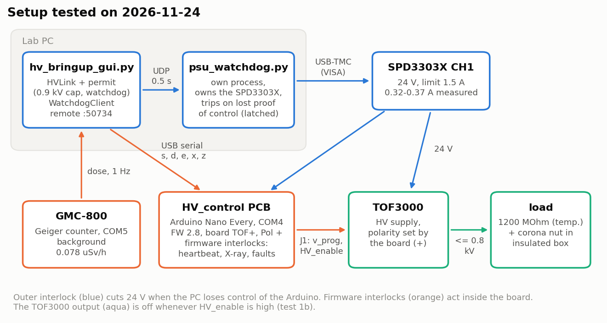
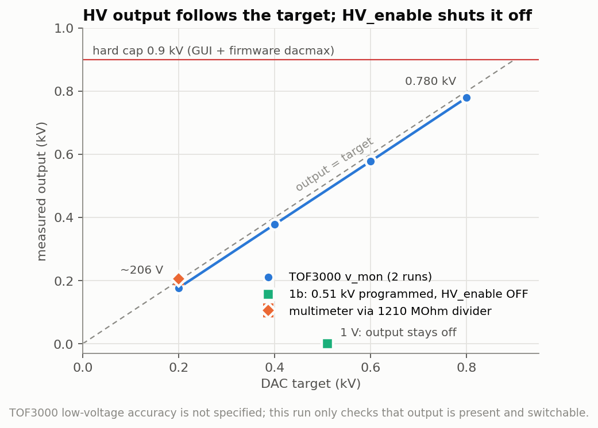
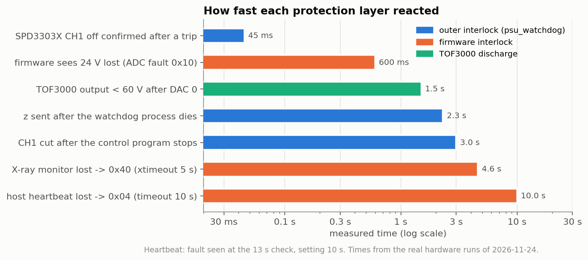
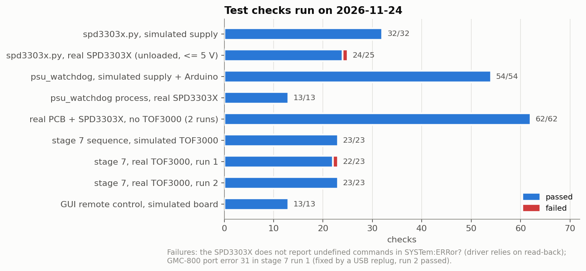

# HV_control v2: supply interlock and stage 7 below 1 kV - summary

Date: 2026-11-24. Board TOF+ (HV_control v1.3, Board B, FW 2.8, Pol +) on COM4, SPD3303X bench supply, positive TOF3000.

## 1. Outcome

This stage is **complete**. Its goal was to show that the full chain works and that every protection layer acts, all at low voltage:

- the PC talks to the board
- the 24 V supply powers the board and the TOF3000
- the TOF3000 produces an output, and the HV_enable line switches it off
- every protection layer acts

The accuracy of the TOF3000 output at low voltage was **not** a goal: the supply is not accurate in this range. 30 kV operation is the next stage (section 6).

- **Output present and switchable:**
  - the output followed the DAC target up to 0.8 kV
  - an independent multimeter check at 0.2 kV read about 206 V
  - with HV_enable high (`e 0`) and 0.51 kV programmed, the output stayed at ~1 V (test 1b)
- **Never above 1 kV:** the highest monitored output was 0.782 kV. Two hard caps at 0.9 kV were both shown to refuse higher targets: the GUI permit and firmware `dacmax` in RAM.
- **Every protection layer reacted on the real hardware** (Figure 2):
  - the new outer interlock (psu_watchdog cuts the 24 V)
  - the firmware heartbeat
  - the firmware X-ray interlock, both back-off and monitor-lost
  - the firmware reaction to a 24 V loss
- **Test tally:** 268 checks across 9 suites. 266 passed. Both failures are understood (Figure 3).

## 2. What was added

All files are in `HV_control_v2/python/`.

| File | Purpose |
|---|---|
| `spd3303x.py` | pyvisa driver + CLI for the Siglent SPD3303X. It is USB-TMC via NI-VISA, not a COM port. Range and soft-limit checks; every setpoint and output state is read back. |
| `psu_watchdog.py` | Outer interlock, runs as its own process and owns the SPD3303X. Switches CH1 (24 V) off and latches when the control program stops proving control of the Arduino. `WatchdogClient` is the heartbeat side, inside the GUI. |
| `hv_link.py` | `last_ok`, `last_status`, and an optional `permit` hook that refuses `e 1` / `d N>0` with `ERR PSU_WD` |
| `hv_bringup_gui.py` | 24 V / watchdog strip, session HV cap (`--hv-max-kv`), "Stage 7 tests" tab, local remote control (`--remote`, 127.0.0.1:50734), and autorun |
| `stage7_tests.py` | Stage 7 sequence below 1 kV. Every wait loop checks v_mon and aborts with `z`. |
| `hv_remote.py` | CLI for the GUI remote control. Commands are whitelisted; the cap and permit still apply. |
| `test_psu_watchdog.py`, `test_stage7_sim.py` | Offline tests: simulated supply, board and TOF3000. |
| `../PSU_watchdog.md` | Design, trip conditions, run instructions, detailed test log |

How the outer interlock works:
- The GUI sends a heartbeat every 0.5 s, but only while the Arduino is answering.
- The watchdog trips if any of these happens:
  - no heartbeat for 3 s
  - the Arduino has not answered for 5 s
  - the serial port closes
  - the Arduino resets by itself
  - the SPD3303X is lost
  - CH1 is found off
  - disarm while HV is not off
  - its own window is closed
- After a trip it needs `Reset interlock` and then `24 V ON`. Both require the Arduino answering with HV off and DAC 0.
- The GUI also sends `z` to the Arduino when the watchdog trips or stops answering. Then HV cannot come back when 24 V returns.

## 3. Results

### 3.1 Output vs target

| DAC target | v_mon run 1 | v_mon run 2 | Note |
|---|---|---|---|
| 0.2 kV | 0.177 kV | 0.177 kV | Multimeter ~206 V: 1.7 V on 10 MΩ behind the 1200 MΩ temporary resistor, ratio 1/121 |
| 0.4 kV | 0.378 kV | 0.378 kV | |
| 0.6 kV | 0.578 kV | 0.578 kV | |
| 0.8 kV | 0.780 kV | 0.779 kV | |
| 0.51 kV programmed, HV_enable high (1b) | 0.0005 V on v_mon (~1 V) | 0.0002 V | The TOF3000 is off when HV_enable is high |

Other observations:
- v_mon reads about 20-30 V below the output at these voltages. The DAC programming is close to the true output.
- i_mon stayed ≈ 0 and there were no discharge events.
- 24 V supply current was 0.32 A with HV off (PCB alone: 0.075 A) and 0.37 A at 0.8 kV.
- The output fell below 60 V within 1.5-2 s after the DAC reached 0.

### 3.2 Protection response times

| Event | Reaction | Measured |
|---|---|---|
| Control program stops / killed (with HV on, and as a separate process) | watchdog trips, CH1 off | 3.0 s / 3.1 s |
| Trip requested | CH1 off confirmed in the status word | 45 ms |
| 24 V lost while HV on | firmware ADC fault 0x10/0x11, HV off by itself | 0.6 s |
| Watchdog process killed at 0.6 kV | GUI sends `z` once; HV off; `e 1` refused until the watchdog is back | 2.3 s |
| X-ray reading above `xthr` (simulated 1.00 µSv/h, threshold 0.40) | back-off 400 units every 3 s, raising refused (`ERR XRAY`), released below 80 % | 0.575 → 0.204 kV in ~4 s |
| X-ray readings stop (`xtimeout 5`) | flt 0x40, ramp down, HV off; 24 V untouched | 4.6 / 5.6 s |
| `xback 0` and an alarm | flt 0x20 latched, HV off | < 1 s |
| PC silent, firmware heartbeat (`timeout 10`) | flt 0x04, ramp down, HV off | seen at the 13 s check |

X-ray input:
- The real GMC-800 (COM5) forwarded its background, 0.078 µSv/h, which the firmware received as `xr=12`.
- Alarm levels were simulated. No X-rays are expected below 1 kV.

### 3.3 Test tally

The two failures:
1. **`SYSTem:ERRor?` on the SPD3303X does not report an undefined command.** The driver therefore relies on reading back setpoints and output states. This is documented in `spd3303x.py`.
2. **Stage 7 run 1: the GMC-800 port did not open** (Windows error 31 at every baud rate, although Windows showed the device as OK). Fixed by a second USB replug. Run 2 passed 23/23.

Reports:
- `python/logs/stage7_report_20261124_165712.md` (run 1)
- `python/logs/stage7_report_20261124_171700.md` (run 2)

## 4. Settings and state at the end of this stage

- SPD3303X CH1: 24.000 V, limit 1.500 A, ON. psu_watchdog is running and ARMED by the GUI.
- GUI: running with `--hv-max-kv 0.9 --remote`. Board connected, HV off, DAC 0.
- Board RAM (not saved; a reset or USB replug restores EEPROM): `dacmax 1771` (0.9 kV), `cable 1`.
- EEPROM unchanged: `timeout 10`, `sthr 2500`, `cable 0`, `xthr 0`, `xtimeout 0`, `dacmax 59055`.
- Python: only `C:\Users\CeNTREX\AppData\Local\Programs\Python\Python311\python.exe` has both pyserial and pyvisa. `运行GUI.bat` picks Anaconda, which has neither.
- Code: branch `hv-control-v2-fw2.8`, **not committed yet**.

## 5. Notes and open points

- The 1200 MΩ resistor in front of the corona nut was for this test only. The experiment will use **200 MΩ between the supply and the electrode**.
- Cannot be confirmed from this run: whether a DB15 adapter board was fitted during 1b. If it is fitted later, repeat 1b.
- The first COM4 open of the day failed once with error 995, then worked. COM5 (GMC-800) needed a replug. Watch for USB-serial flakiness: both use the same USB hub (location 1-5.x).
- Not tested yet (need hands):
  - unplug the Arduino USB
  - press the Nano reset button
  - close the watchdog window (CTRL_CLOSE handler)
  - switch CH1 off on the front panel
  - unplug the SPD3303X USB
- Not covered by design: the PC freezing completely. That case is left to the firmware heartbeat and the isolator default on HV_enable.
- The negative board (TOF−) has not been set up.

## 6. Before the 30 kV stage

1. **Commit** the code and docs above.
2. **Load resistor.** Install the 200 MΩ series resistor and check its voltage and power rating. In a full arc to ground it sees 30 kV and 150 µA, i.e. 4.5 W.
3. **Firmware settings.** Set `c cable 1` and `c save`, as the plan requires from stage 7 on.
4. **Manual loss-of-control tests.** Do the remaining tests listed in section 5 once, with HV off.
5. **TOF3000 manual items:**
   - 24 V current at full load, against the 1.5 A limit
   - v_mon / i_mon scales
   - internal bleeder, and the output decay when the 24 V is cut at high voltage
6. **Raise the voltage in stages,** following the plan (1 kV steps to 5 kV, then 15-20 kV before 30 kV):
   - raise `--hv-max-kv` and the firmware `dacmax` cap stepwise, together with the abort level in `stage7_tests.py`
   - watch v_mon, i_mon, events and the 24 V current at each step
7. **Stage 8:**
   - set the X-ray threshold from the GMC-800 background (0.078 µSv/h here) and from real data at 15-20 kV; save `xthr` and `xtimeout`
   - set the spark limits (`spark`, `sparkwin`, `backoff`), counting only (`spark 0`) first
8. **Python environment.** Pick one interpreter for the GUI: install pyserial and pyvisa into Anaconda, or point `运行GUI.bat` at Python 3.11.

Figures: `python make_figures.py` in this folder regenerates `fig1`-`fig4` from the numbers above.
